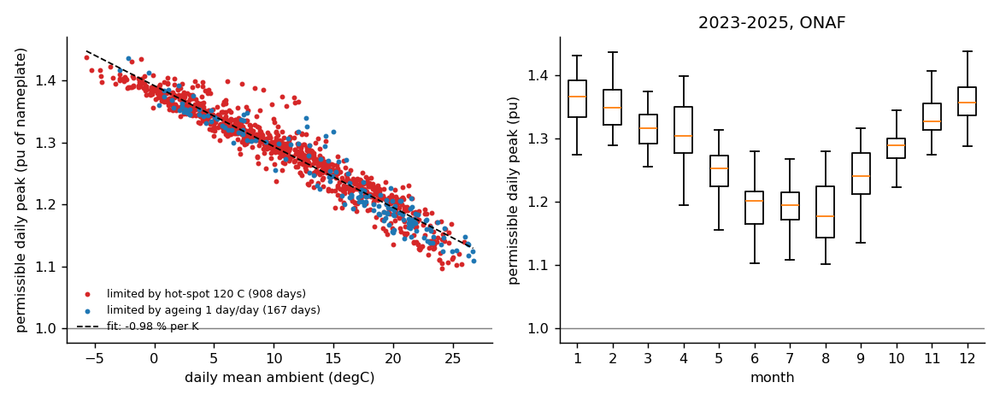
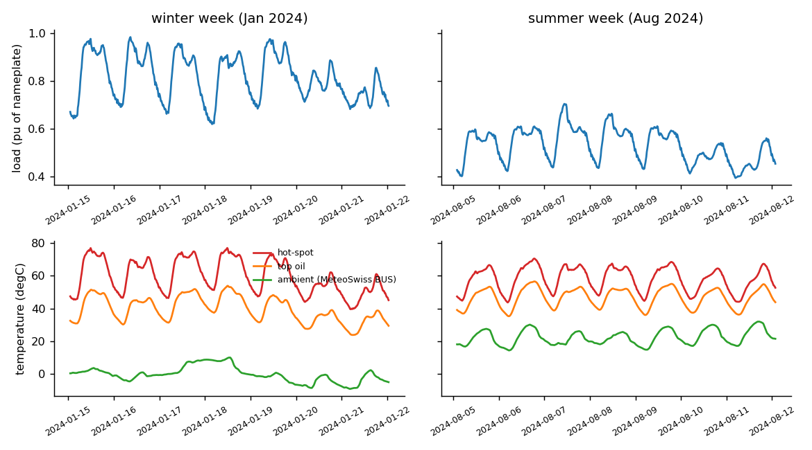

# Transformer Hot-Spot & Dynamic Rating on Real Swiss Load and Weather

How hot does a power transformer get when it serves the real Swiss load, outdoors near Baden, and how much
more could it carry without breaking the IEC loading limits or wearing out its insulation faster?

This project implements the thermal model of **IEC 60076-7:2018** (the loading guide for oil-immersed
power transformers) and drives it with three years of measured data:

* **Load:** Swissgrid's 15-minute total end-user consumption of the Swiss control area, 2023-2025
  (105,216 intervals; peak 9.58 GW, mean 6.10 GW, load factor 0.64). The national shape is scaled so its peak
  equals a chosen per-unit load of the transformer.
* **Ambient:** MeteoSwiss SwissMetNet station Buchs/Aarau (BUS, about 15 km from Baden), hourly air temperature.

## In short

| Question | Answer (ONAF medium power transformer, IEC typical parameters) |
|---|---|
| Sized for the peak (peak load = nameplate), how fast does the paper age? | **1.2 days per year** with real ambient (4.7 days/year if the ambient were a constant 20 degC). The hottest hot-spot in three years is 86 degC. |
| How much peak load can it carry within the IEC normal cyclic limits? | **1.38 x nameplate**, limited by the 120 degC hot-spot, not by ageing. The textbook constant-20-degC ambient gives 1.21 x. |
| Why so much headroom? | Swiss load peaks on cold winter evenings. With the same load shifted by six months, so its peak meets summer weather, the limit falls to **1.15 x**, below the textbook value. |
| Day-by-day dynamic rating | 1.10 to 1.44 x nameplate, mean 1.28; **-0.98 % per K** of daily mean ambient. Winter 1.36, summer 1.19. |
| Worst week | 18-24 Aug 2023 heatwave (7-day mean 25.2 degC): rating fell to 1.11 x, still above nameplate. |
| Climate sensitivity | 3 K warmer weather all year lowers the limit from 1.38 to 1.36 x. |

## Model

IEC 60076-7 describes the top-oil temperature and the winding hot-spot with three first-order equations
(K = load / rated current, theta_a = ambient):

```
k11 tau_o  d theta_o/dt = dtheta_or ((1 + K^2 R)/(1 + R))^x - (theta_o - theta_a)
k22 tau_w  d dth1/dt    = k21 dtheta_hr K^y - dth1
tau_o/k22  d dth2/dt    = (k21 - 1) dtheta_hr K^y - dth2          hot-spot = theta_o + dth1 - dth2
```

The two hot-spot terms reproduce the overshoot seen in heat-run tests: the winding heats in minutes, and the
oil flow catches up later. Parameters are the standard's typical values (Table 4) for four cooling types:
distribution ONAN, medium/large ONAN, ONAF and OF. Insulation ageing uses the IEC relative ageing rates,
normal Kraft paper (doubles every 6 K above 98 degC) for distribution units and thermally upgraded paper
(reference 110 degC) for the others.

Two solvers are implemented:

* `simulate_difference`: the standard's own difference equations (explicit Euler). These need steps well
  below the 14-minute winding time constant.
* `simulate_exact`: the same equations integrated **exactly** over each step, with load and ambient held
  constant within the step. This is unconditionally stable, runs directly on the 15-minute data, and vectorises
  across thousands of cases. It is the production solver.

**Daily dynamic rating:** for each day, bisection finds the largest peak load such that, with that day's
load shape (and the two preceding days at the same scaling, for a consistent oil state), the hot-spot stays
at or below 120 degC, top oil at or below 105 degC, current at or below 1.5 pu (IEC normal cyclic loading
limits), and the day's insulation ageing at or below one day. All 1,075 days are solved in parallel in
about 0.3 s. The six days with a clock change are left out.

## Verification

| Check | Result |
|---|---|
| Rated load at 20 degC ambient, all four cooling types | hot-spot 98.000 degC (the IEC reference point) |
| Exact integrator vs closed-form step response (0.5 to 1.5 pu) | max error 1.4e-13 K |
| IEC difference equations vs closed form, dt = 4 ... 0.25 min | error 4.15 to 0.23 K, **order 1.04** (first order, as expected for explicit Euler) |
| Exact 15-min solver vs IEC equations on 1-min sub-steps, full year 2024 | max difference 0.07 K, mean 0.015 K |
| Oil energy balance (stored heat = heat in - heat out), every 15-min step of 2024 | relative residual 1.4e-15 per step, 1.7e-20 cumulative |
| Rating search | re-simulating a day at its rating stays within all limits; 1 % above breaks one |

The thermal model is a lumped heat balance: there is no flow field, so mass and momentum balances do not
apply. The energy balance of the oil is checked to round-off (above). 12 automated tests in `tests/`.

## Results

### Peak load = nameplate (the static sizing rule), 2023-2025

| Cooling | Ambient | Max hot-spot (degC) | Ageing (days/year) |
|---|---|---|---|
| Distribution ONAN | real | 83.3 | 4.0 |
| | constant 20 degC | 93.5 | 14.4 |
| Medium/large ONAN | real | 85.7 | 1.1 |
| | constant 20 degC | 96.4 | 4.7 |
| Medium/large ONAF | real | 86.0 | 1.2 |
| | constant 20 degC | 97.0 | 4.7 |
| Medium/large OF | real | 82.0 | 0.7 |
| | constant 20 degC | 95.8 | 3.3 |

A transformer sized only for the national load peak is thermally lightly used: the average load is 64 % of
the peak, and the peak arrives in cold weather.

### Largest peak load within the IEC normal cyclic limits (pu of nameplate)

| Cooling | Real ambient | Constant 20 degC | Real + 3 K | Real, load shifted 6 months |
|---|---|---|---|---|
| Distribution ONAN | 1.41 | 1.24 | 1.38 | 1.18 |
| Medium/large ONAN | 1.39 | 1.22 | 1.37 | 1.16 |
| Medium/large ONAF | 1.38 | 1.21 | 1.36 | 1.15 |
| Medium/large OF | 1.33 | 1.19 | 1.31 | 1.15 |

In every case the 120 degC hot-spot limit binds first. At that loading the insulation ages only 0.05 to
0.49 years per year, so the short-time temperature limit, not long-term ageing, sets the capacity. The
coincidence of the Swiss winter peak with cold weather is worth about 0.23 pu, more than the whole gain over
the textbook rating.

### Daily rating (ONAF)



The permissible daily peak falls almost linearly with temperature, by 0.98 % of nameplate per kelvin.
Hot-spot binds on 908 days and ageing on 167. The ageing-limited days are warmer on average (15.0 vs
10.7 degC daily mean): when the whole day runs hot, the one-day ageing budget runs out before the peak reaches 120 degC.



## Limitations

* **IEC typical parameters**, not a specific transformer. A real study would use the unit's heat-run test
  report (rise values, time constants, exponents).
* **National load shape.** A single substation transformer sees a peakier, more local load. The aggregate
  Swiss profile is smoother, which flatters the static result. The six-month shift shows how strongly the
  conclusions depend on when the peak happens.
* **Ambient from one station**, hourly, with no solar heating of the tank and no wind effect on the coolers.
* The IEC equations use fixed exponents and do not model how oil viscosity changes at low temperature.
* Days with a clock change (6 of 1,097) are excluded from the daily rating.

## Files

| Path | Content |
|---|---|
| `src/xfmr/iec60076_7.py` | IEC parameters, difference-equation and exact solvers, step response, energy balance, ageing |
| `src/xfmr/rating.py` | data loading, per-unit scaling, vectorised daily rating, maximum uniform loading |
| `scripts/fetch_data.sh` | downloads the public raw data |
| `scripts/prepare_data.py` | Swissgrid local time to UTC, joins MeteoSwiss ambient, 15-min table |
| `scripts/run_analysis.py` | all results, figures and `results/summary.json` |
| `results/daily_rating.csv` | rating and binding limit for each day |

## Run

```bash
pip install -r requirements.txt
bash scripts/fetch_data.sh            # about 80 MB of public data
python scripts/prepare_data.py        # writes data/load_ambient_15min.csv.gz (included in the repo)
python scripts/run_analysis.py        # about 40 s
python -m pytest -q tests             # 12 tests
```

Data: Swissgrid AG, "Energy overview Switzerland" (swissgrid.ch); Federal Office of Meteorology and
Climatology MeteoSwiss, SwissMetNet open data (opendata.swiss).
